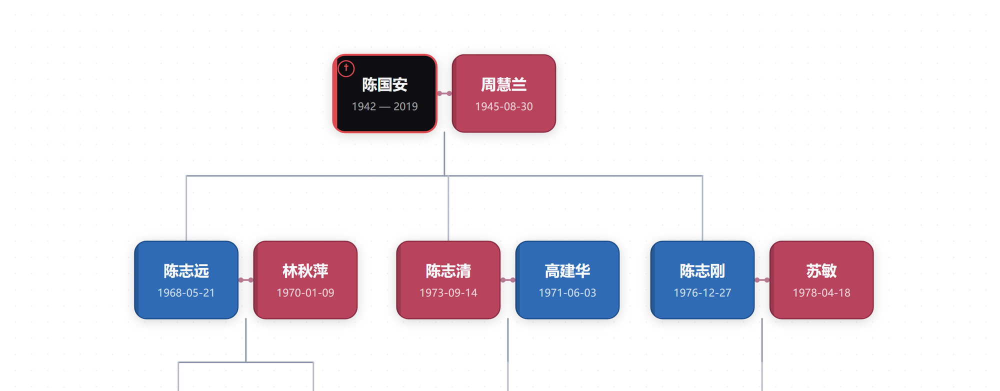

# Family Tree Canvas

[English](README.md) · 简体中文

像在纸上打草稿那样，在画布上排一张家谱 —— 不是一张算出来的图，而是一块自己动手摆的板子。

卡片会自动吸附到代际行：横向随你拖，纵向永远齐整。一个共用的人物库同时供给多张布局，而每个人在你的库里就是一篇笔记。



## 为什么还要再做一个家谱插件

目录里已经有几个族谱插件，做法都是从笔记属性里读关系、自动给你画出关系图。这个反过来：**位置你定**，账由插件来记。

家里情况一乱，自动排版那套就顶不住了 —— 再婚、过继、从小跟爷爷奶奶长大的、只记得两代的分支。算法总得在某个地方妥协，画布不用。

## 功能

- **一个人物库，多张布局。** 同样的人，可以出现在「全家」布局、「我这一户」布局、「爷爷这一支」布局里。在任一张图里改个名字或生卒日期，其它图跟着变，而每个人始终只对应一篇笔记。
- **吸附到行。** 卡片只横着拖；松手就落进某一代。紧缩的时候顺手把空行收干净。
- **紧缩空间并居中。** 走一遍整齐树算法：子女排到父母底下，整棵树收紧，父母落在子女正中间。可以反复点，点第二次结果不会再变。
- **夫妻换位。** 一键把夫妻左右对调，底下的子树跟着走。
- **亲戚计算器。** 选两个人，给出中文称呼 —— 公公、大姨子、堂侄女 —— 并把推算路径一路列出来。能算到 8 步以内的亲戚，选人时可以搜索。
- **主题。** 六个预设，也能全部自己调：男／女／未填的卡片底色、卡片文字色、已故者的填充与描边、亲子线和配偶线的颜色、线宽。悬停和选中的描边自动派生，浅色卡片上也看得清。
- **导出 Markdown。** 把一张布局写成能读的笔记：按代分节，写清婚姻和兄弟姐妹，附上到各人笔记的链接。
- **备份。** 一键写出带时间戳的 JSON，人物库和所有布局都在里面，存到你指定的文件夹。恢复时从列表里挑一份，动手前会先给当前状态另存一份保险。
- **英文和简体中文。** 在设置里切换，整个界面跟着变。

## 安装

上架之后，在**设置 → 第三方插件 → 浏览**里搜 **Family Tree Canvas** 即可。

在那之前只能手动装：

1. 从[最新的 release](https://github.com/zyk-13/family-tree-canvas/releases/latest) 下载 `main.js`、`manifest.json`、`styles.css`。
2. 三个文件放进 `<你的库>/.obsidian/plugins/family-tree-canvas/`。
3. 重启 Obsidian，在**设置 → 第三方插件**里启用 **Family Tree Canvas**。

## 用法

1. 命令面板里运行**打开家谱图**，或点左侧边栏的网络图标。
2. **加人** —— 人物图标从人物库往里添；库里没这个名字就当场建一张新卡。
3. **摆位置** —— 拖卡片。拖夫妻中间那个小把手，可以换谁站左边。
4. **右键卡片**：编辑、删除、加配偶、加子女、换位、打开笔记。
5. 排歪了就点**紧缩空间并居中**；后悔就点**撤销**。

## 数据存在哪

| 文件 | 内容 |
| --- | --- |
| `.obsidian/plugins/family-tree-canvas/graph.json` | 人物库和所有布局 |
| `.obsidian/plugins/family-tree-canvas/data.json` | 插件设置 |
| 你选的备份文件夹（默认 `family/家谱备份`） | 带时间戳的 JSON 备份 |

**卸载插件会把它的文件夹一起删掉，`graph.json` 也在里面。** 卸载前先导出一份备份 —— 工具栏上那个下载图标就是干这个的。

## 隐私

不联网、不上报、不需要账号。所有东西都留在你自己的库里，断网也能完整使用。

## 开发

```bash
npm install
npm run build   # 把 src/ 打包成 main.js
npm run dev     # 改动后自动重建
```

源码都在 `src/`：

| 文件 | 作用 |
| --- | --- |
| `src/main.js` | 插件入口：命令、备份恢复、设置页 |
| `src/view.js` | 画布视图：平移缩放、拖拽、吸附、工具栏 |
| `src/layout.js` | 布局计算、连线几何、整齐树紧缩 |
| `src/model.js` | 数据模型 v4、人物库、布局、持久化 |
| `src/modals.js` | 人物编辑、布局管理、亲戚计算、备份、主题等弹窗 |
| `src/kinship.js` | 关系路径搜索与中文称呼 |
| `src/theme.js` | 主题预设、派生色、CSS 变量输出 |
| `src/i18n.js` | 英文／中文字符串 |
| `src/backup.js` | 备份信封格式、解析、格式化 |

## 许可

MIT，见 [LICENSE](LICENSE)。
